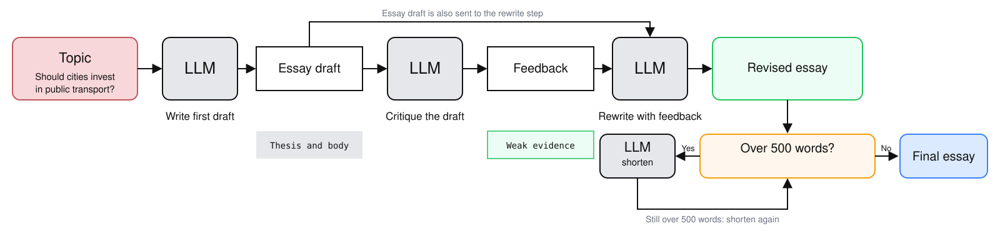

# Essay draft, critique, rewrite

A three-step workflow with a Gemini model. The model writes an essay draft, reviews it, and then rewrites it using its own critique.

It practices:

- Chaining model calls, where the output of one step is the input of the next
- Different system prompts for each role (writer, teacher, writer)
- Temperature 0 for every step, so results are consistent

## Requirements

- Python 3.10 or higher
- A [Google AI Studio](https://aistudio.google.com/) API key

## Installation

From the `essay-draft-critique-rewrite/` folder:

```bash
python3 -m venv venv
source venv/bin/activate

pip install -r requirements.txt
```

## API key setup

The SDK reads the key from an environment variable. Don't hardcode it in the code or commit it to the repo.

```bash
export GEMINI_API_KEY="your-gemini-key"
```

## Running

Run the script from the `essay-draft-critique-rewrite/` folder. Pass the topic as arguments:

```bash
python essay_workflow.py "Should cities invest in public transport?"
```

Without arguments, the script uses a default topic. The output shows the three steps in order: draft, critique, and rewrite.

## How it works



## Structure

```
ai-practice-lab/
└── essay-draft-critique-rewrite/
    ├── essay_workflow.py    # draft, critique and rewrite steps
    ├── requirements.txt     # dependencies
    └── README.md
```

## Notes

- Models change over time. If the model in `MODEL` stops being available, check the current Gemini model names in Google AI Studio and update the constant.
- This repo is for learning, not production code.
