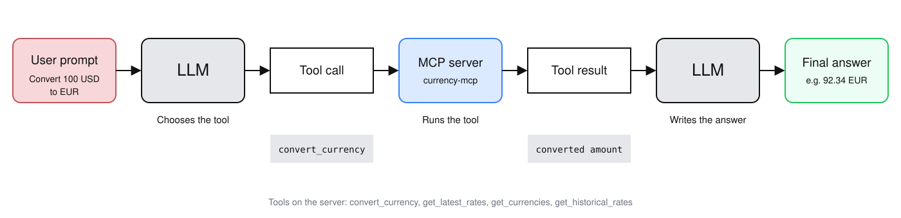

# Exchange MCP agent

An agent that uses a currency exchange MCP server to answer currency questions. It reads the server's tools, lets the model choose which one to call, and prints the conversation.

## MCP server

- URL: `https://currency-mcp.wesbos.com/mcp` (streamable HTTP)

Tools available on the server:

- `convert_currency`
- `get_latest_rates`
- `get_currencies`
- `get_historical_rates`

The example in `agent.py` uses `convert_currency`. The prompt asks for 100 USD in EUR, and the model calls that tool to get the answer.

## How it works



## Requirements

- Python 3.10 or higher
- A Google AI Studio API key

## Installation

From the `exchange-mcp-agent/` folder:

```bash
python3 -m venv venv
source venv/bin/activate

pip install -r requirements.txt
```

## API key setup

The model reads the key from an environment variable. You can put it in a `.env` file in this folder. Don't commit that file.

```bash
GOOGLE_API_KEY="your-gemini-key"
```

## Running

Run the script from the `exchange-mcp-agent/` folder:

```bash
python3 agent.py
```

The output shows the available tools, the conversation with the model, the tool call, and the token usage.

